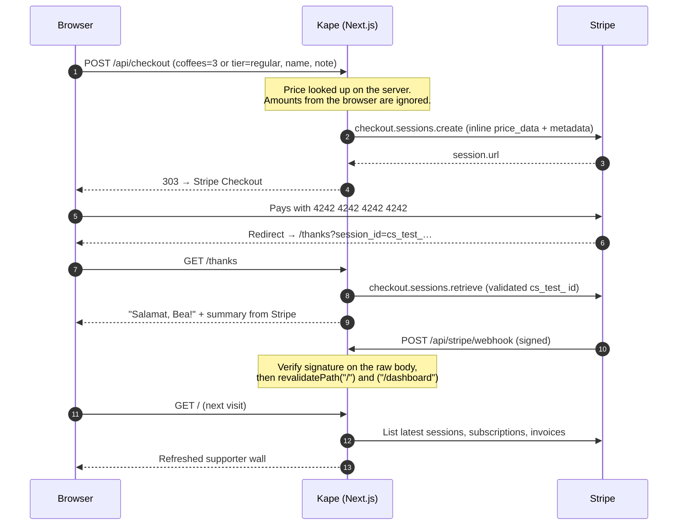

# Kape ☕

**Kape** (Tagalog for "coffee") is a "Buy Me a Coffee" page for Filipino creators. A visitor picks 1, 3 or 5 coffees, leaves a note, pays with Stripe Checkout, and their note lands on the supporter wall seconds later. Supporters can also join a monthly membership and manage it in the Stripe Customer Portal. The creator gets a password-protected dashboard with earnings, a 30-day chart and tables of supports and members.

The demo creator is **Mara Santos**, a fictional film photographer from Pampanga. The mascot is **Tasa** (Filipino for "cup"): idle while you browse, hopping when you pick 5 coffees, happy on the thanks page, and asleep when payments are off.

Built with Next.js 16 (App Router), TypeScript strict, Tailwind CSS v4, the official `stripe` SDK and Vitest. Payments run in a **Stripe sandbox only**.

## Payment flow



## Why Stripe is the database

There is no database and no auth provider. Stripe already stores everything this app needs:

| Kape concept | Stripe object |
| --- | --- |
| Supporter | Completed Checkout Session (`mode=payment`, `payment_status=paid`) |
| Name, note, coffee count, privacy | Checkout Session `metadata` |
| Refunded support | `payment_intent.latest_charge.refunded` |
| Member | Subscription with `metadata.app = "kape"` |
| Membership revenue | Paid invoices of those subscriptions |

Every object Kape creates is tagged `metadata.app = "kape"`, and reads filter on that tag. The upside: zero infrastructure, no data to sync and no drift between "what we think was paid" and what was actually paid. Webhooks don't need to write anything; they only tell Next.js to refresh the cached page, so repeated or out-of-order deliveries are harmless. The trade-offs are listed under [Known limits](#known-limits).

### Security choices

- **Prices live on the server.** The browser sends only `coffees` (1, 3 or 5) or `tier` (`regular`, `barista`). Anything else is rejected, including `toString` and other inherited object keys.
- **Test keys only.** Keys that don't start with `sk_test_`, `rk_test_` or `rkcs_test_` (the limited key an unclaimed sandbox gives you) are refused. There is no live-key code path.
- **Signed webhooks.** The signature is checked against the raw request body with `STRIPE_WEBHOOK_SECRET`.
- **No trusted URLs.** The thanks page reads amounts from Stripe, and session ids must match `cs_test_…`. Notices map fixed query flags to fixed copy, so URL text never reaches the page.
- **Private supports stay private.** The public wall shows "Someone" with no note. Private details are stripped on the server before rendering.
- **Dashboard cookie.** It stores a SHA-256 hash, never the password. It's httpOnly, `sameSite=lax`, secure on https and lasts 8 hours, and it's compared with `timingSafeEqual`.

## Local setup

You need Node.js 22+ and the [Stripe CLI](https://docs.stripe.com/stripe-cli).

```bash
npm install
cp .env.example .env.local
```

### 1. Create a sandbox (no `stripe login` needed)

```bash
stripe sandbox create
```

This creates an anonymous sandbox with no Dashboard, which expires after 7 days. Copy its secret key (`rkcs_test_…` for an unclaimed sandbox, or `sk_test_…`) into `.env.local` as `STRIPE_SECRET_KEY`.

Because you never ran `stripe login`, give the CLI the key for the rest of this session:

```bash
export STRIPE_API_KEY=sk_test_...        # PowerShell: $env:STRIPE_API_KEY="sk_test_..."
```

### 2. Forward webhooks

In a second terminal (with `STRIPE_API_KEY` set):

```bash
stripe listen --forward-to localhost:3000/api/stripe/webhook
```

It prints a signing secret (`whsec_…`). Put it in `.env.local` as `STRIPE_WEBHOOK_SECRET`.

### 3. Set a dashboard password and run

```bash
# .env.local
DASHBOARD_PASSWORD=pick-something-long
LOOM_URL=            # optional walkthrough link for the "Payments are napping" card
```

```bash
npm run dev          # http://localhost:3000
```

With no keys at all, the site runs in **demo mode**: sample supporters and members, and a sleepy Tasa where the pay buttons would be.

> **Network blocks Google Fonts?** `next/font/google` downloads fonts at build time. If `fonts.googleapis.com` is unreachable, use `npm run dev:offline` and `npm run build:offline`. They fetch the same font files from jsDelivr and serve them to Next.js locally. Vercel builds don't need this.

### Scripts

| Command | What it does |
| --- | --- |
| `npm run dev` | Dev server |
| `npm test` | Vitest (pricing, Checkout params, mapping, stats, webhook, auth) |
| `npm run typecheck` | Route type generation + `tsc --noEmit` |
| `npm run build` | Production build |
| `npm run lint` | ESLint |

## Test checklist

Use card **4242 4242 4242 4242**, any future expiry date, any CVC and any postcode.

- [ ] **Demo mode:** with `STRIPE_SECRET_KEY` empty, `/` loads with sample data and the "Payments are napping" card with sleepy Tasa. `/dashboard` opens without a password.
- [ ] **Coffee:** pick 3 coffees, add a name and note, and pay. You land on `/thanks` with happy Tasa and "Salamat, {name}!".
- [ ] **Wall:** within seconds, `stripe listen` shows `checkout.session.completed → 200` and the note appears on `/`.
- [ ] **Private:** pay again with "Keep my name and note private" on. The wall shows "Someone" with no note.
- [ ] **Validation:** a tampered form (for example `coffees=2` or `tier=toString`) bounces back with the "didn't look right" notice.
- [ ] **Cancel:** back out of Checkout. The home page shows the "checkout was canceled" notice.
- [ ] **Dashboard:** `/dashboard` asks for the password. A wrong password is rejected. After logging in, the totals include your payments.
- [ ] **Membership:** join Regular or Barista, then click **Manage membership** on the thanks page. In the Customer Portal, cancel it; it ends at the period end. The dashboard shows the change after `customer.subscription.updated`.
- [ ] **Refund:** find the PaymentIntent id (`stripe checkout sessions list --limit 3`, look for `payment_intent`), then:

  ```bash
  stripe refunds create --payment-intent=pi_...
  ```

  The coffee disappears from the wall and shows as **Refunded** on the dashboard.

## Deploying to Vercel

1. Push the repo to GitHub and import it in Vercel. The framework is detected automatically.
2. Add environment variables: `STRIPE_SECRET_KEY`, `DASHBOARD_PASSWORD`, optionally `LOOM_URL`.
3. Deploy, then register the production webhook from the CLI (the sandbox has no Dashboard):

   ```bash
   stripe post /v1/webhook_endpoints \
     -d url=https://YOUR-APP.vercel.app/api/stripe/webhook \
     -d "enabled_events[]=checkout.session.completed" \
     -d "enabled_events[]=checkout.session.async_payment_succeeded" \
     -d "enabled_events[]=invoice.paid" \
     -d "enabled_events[]=customer.subscription.updated" \
     -d "enabled_events[]=customer.subscription.deleted" \
     -d "enabled_events[]=charge.refunded"
   ```

4. The response includes `"secret": "whsec_…"`. Add it as `STRIPE_WEBHOOK_SECRET` in Vercel and redeploy.

The Customer Portal configuration is created through the API the first time someone clicks **Manage membership**. It's tagged `metadata.app = "kape"` and reused after that.

## Sandbox expired?

Anonymous sandboxes last 7 days. When one expires, every Stripe call fails, and Kape falls back to demo mode on its own: sample data, sleepy Tasa and pay buttons swapped for the "Payments are napping" card (linked to `LOOM_URL` if set). Nothing crashes.

To bring payments back:

1. `stripe sandbox create`, then update `STRIPE_SECRET_KEY` (locally and in Vercel).
2. Register the webhook again (step 3 above) and update `STRIPE_WEBHOOK_SECRET`.
3. Redeploy. The portal configuration is recreated on first use.

Old supporters lived in the old sandbox, so the wall starts empty.

## Known limits

- **Reads the latest 100 sessions** (and 100 subscriptions and invoices). Older data isn't paginated, so lifetime totals undercount past that.
- **Single creator.** All creator content lives in `src/lib/config.ts`.
- **USD only**, at $3 per coffee.
- **Refunds are all-or-nothing on the wall.** A support is hidden once its charge is fully refunded.
- **Portal access is by Checkout Session id.** Anyone holding a member's `session_id` URL can open their portal. That's acceptable for a demo, but a real product would add customer login.
- **Page freshness:** the home page revalidates every 60 seconds and right after each webhook.

## Project layout

```
src/app/                 routes: /, /thanks, /dashboard, /api/*
src/components/          Tasa, support card, wall, chart, ...
src/lib/                 pricing, checkout params, Stripe mapping, stats, auth (unit tested)
scripts/offline-fonts.mjs  font workaround for restricted networks
CLAUDE.md, PLAN.md       project rules and build plan
```

## What I learned

<!-- Fill this in: what surprised you, what you'd do differently, what you'd build next. -->
